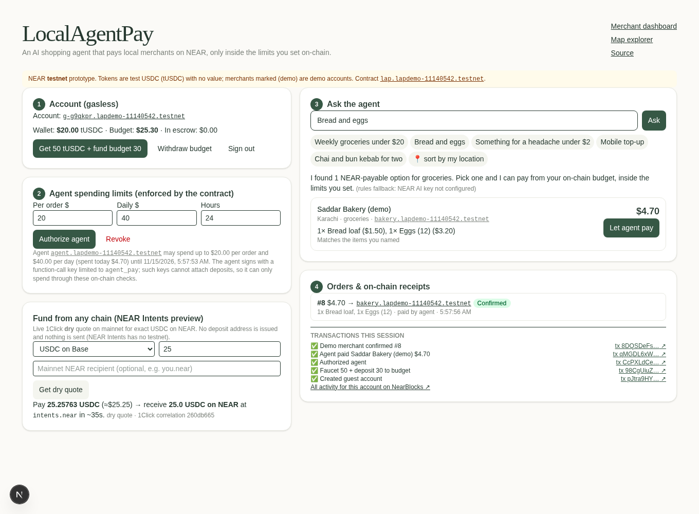
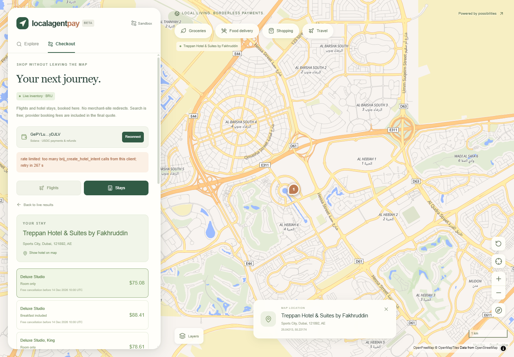

# LocalAgentPay: an AI shopping agent that can only spend what a NEAR contract allows

> Built at the **NEAR HACKATHON** (Nov 2026) · Tracks: **`agents`**, **`realworld`** · License: MIT · **Network: NEAR testnet** (test tokens, no real value)

**The problem.** People want an AI assistant that can actually buy everyday things (groceries, chai, medicine, mobile top-ups) from small local shops. Today that means either giving an agent your card/wallet (unbounded risk) or approving every step yourself (no automation). Small merchants in places like Karachi also can't easily accept borderless payments or trust that an online order will be paid.

**What we built.** A user funds an on-chain budget, sets limits (per order, per day, expiry, allowed shops) in a NEAR smart contract, and lets an AI agent pay merchants **inside those limits**. Every payment sits in **escrow** until the merchant confirms (funds released) or refunds (money goes back to the budget). The payer can reclaim an unconfirmed order after its deadline. The agent's key is a NEAR function-call key that can only call `agent_pay` and cannot attach deposits, so a compromised agent still cannot exceed the user's on-chain limits.



## NEAR pieces used

| NEAR feature | Where | What it does here |
| --- | --- | --- |
| Rust smart contract (near-sdk 5.30) | [`contracts/lap/src/lib.rs`](contracts/lap/src/lib.rs) | Escrow orders, user budgets, agent spending policy (per-order cap, daily cap with reset, expiry, merchant allow-list, revoke), merchant registry with on-chain catalogs, NEP-297 events |
| NEP-141 fungible token | [`contracts/mock-usdc`](contracts/mock-usdc/src/lib.rs) + `ft_transfer_call` / `ft_on_transfer` | Testnet `tUSDC` (6 decimals) with a faucet. Funding a budget and direct pay use `ft_transfer_call` into the escrow |
| Function-call access keys | [`scripts/near/deploy-testnet.mjs`](scripts/near/deploy-testnet.mjs) | Agent key limited to `lap.agent_pay`; demo-merchant key limited to `confirm`/`refund`/`set_merchant_active` |
| NEP-366 meta transactions (gasless) | [`lib/near/client.ts`](lib/near/client.ts), [`app/api/near/relay`](app/api/near/relay/route.ts), [`lib/near/relay-policy.ts`](lib/near/relay-policy.ts) | Users sign `SignedDelegate`s in the browser; a relayer pays gas only for allow-listed methods on our two contracts |
| Named accounts | [`app/api/near/guest`](app/api/near/guest/route.ts) | One click creates `g-xxxx.lapdemo-11140542.testnet` with a browser-held key. No wallet install or seed phrase needed to try it |
| NEAR AI Cloud (OpenAI-compatible) | [`lib/agent/near-ai.ts`](lib/agent/near-ai.ts) | Agent planning via a forced `propose_orders` tool call, validated against the on-chain catalog. Uses `NEAR_AI_API_KEY`; falls back to a deterministic rules planner when no key is set |
| NEAR Intents / 1Click API | [`lib/near/intents.ts`](lib/near/intents.ts), [`app/api/funding-quote`](app/api/funding-quote/route.ts) | "Fund from any chain": live **dry** quotes for USDC/ETH/SOL/wNEAR to NEAR USDC (mainnet API, preview only; Intents has no testnet) |
| NearBlocks | UI receipts | Every action links to its testnet transaction |

**Deployed (testnet):** escrow [`lap.lapdemo-11140542.testnet`](https://testnet.nearblocks.io/address/lap.lapdemo-11140542.testnet) · token [`usdc.lapdemo-11140542.testnet`](https://testnet.nearblocks.io/address/usdc.lapdemo-11140542.testnet) · agent [`agent.lapdemo-11140542.testnet`](https://testnet.nearblocks.io/address/agent.lapdemo-11140542.testnet). Addresses: [`lib/near/deployment.testnet.json`](lib/near/deployment.testnet.json).

## Judge quick check (about 3 minutes, no wallet needed)

Hosted app: **https://localagentpay.mateen-nibtap.workers.dev** (or run it locally, below).

1. Open `/` → click **Try as guest** → see `Account: g-xxxx.lapdemo-11140542.testnet` and a `Created guest account` tx link.
2. Click **Get 50 tUSDC + fund budget 30** → see `Budget: $30.00` (one gasless meta-transaction: faucet + `ft_transfer_call` into escrow).
3. Under **Agent spending limits**, keep $20 per order / $40 per day → **Authorize agent** → see "Agent agent.lapdemo-11140542.testnet may spend up to $20.00 per order…".
4. Click the **Bread and eggs** chip → **Ask** → see a proposal from *Saddar Bakery (demo)* for $4.70, priced from the on-chain catalog.
5. Click **Let agent pay** → see order `#N $4.70 … Escrowed`, signed by the agent's restricted key. Budget drops; "In escrow" rises.
6. Click **Merchant: confirm** → status becomes `Confirmed` and the merchant is paid. Or click **Merchant: refund** → `Refunded` and the budget is restored.
7. Set **Per order $10** → **Authorize agent** again → ask **Weekly groceries under $20** ($18 bag) → the UI warns, and **Let agent pay** is rejected *by the contract*: "Amount exceeds the per-order cap".
8. Open `/merchant` → pick *Saddar Bakery (demo)* → see every order and its received balance. You can also register your own shop gaslessly.
9. **Fund from any chain** → **Get dry quote** → see a live 1Click quote, e.g. "Pay 25.26 USDC on Base → receive 25.0 USDC on NEAR". This is a preview only; nothing is sent.

Already-executed testnet transactions (from [`scripts/near/e2e-testnet.ts`](scripts/near/e2e-testnet.ts)):

| Step | Transaction |
| --- | --- |
| Gasless guest account created | [ExiHnqMr…](https://testnet.nearblocks.io/txns/ExiHnqMri8HMG4xxToXamzKNDjPPchVQbsb7Yky1D6T3) |
| Faucet + fund budget (meta-tx) | [3Ejpkoa…](https://testnet.nearblocks.io/txns/3EjpkoAeSU8qjRh7KwAQYzms2SBCyx5Eh4azEga4iehX) |
| User sets agent policy | [EfoRdQQn…](https://testnet.nearblocks.io/txns/EfoRdQQnyWGFmvPKGH7qzTR2ae5v1L7TcuysbHyhJn3J) |
| **Agent pays** (escrowed) | [E96YTq2K…](https://testnet.nearblocks.io/txns/E96YTq2Kr8vsDb68tijy5o9zVNq4pj3Cvhp52TVYxR1Q) |
| **Merchant confirms** (funds released) | [3qpckFnZ…](https://testnet.nearblocks.io/txns/3qpckFnZiWP2yYM89EHMn9jWhvLiHHWpcmnfX2Vuh6jh) |
| Agent pays order 2 | [3DLGSqha…](https://testnet.nearblocks.io/txns/3DLGSqhaq6EQ7KVsVL8tnr3ddG8tS5Nnx3V7pSEu4DeB) |
| **Merchant refunds** (back to budget) | [2hhocQNN…](https://testnet.nearblocks.io/txns/2hhocQNNUuqk5agbaVrUkoprGHq9yxaSeFvcJXTrtneH) |
| Agent over per-order cap → **rejected on-chain** | [3K9T6SoB…](https://testnet.nearblocks.io/txns/3K9T6SoBwbEnDdxs1R9KpcjnnMmnQ9xENbi2FeNZ9AJm) |
| Agent over daily cap → **rejected on-chain** | [GDP9JkQL…](https://testnet.nearblocks.io/txns/GDP9JkQLm4d7MYaxLxfqSo2W1g25z8eC7nqgsGnnJLTL) |
| User revokes agent | [7YKioVgo…](https://testnet.nearblocks.io/txns/7YKioVgoKTS1iTAuzNZeqoryxKLxv7xDspP1EUemDgcz) |
| Agent after revoke → **rejected on-chain** | [4KWyi9iT…](https://testnet.nearblocks.io/txns/4KWyi9iTtrdYAQgcUuhkFbniXwT69k191zPCU53gKatH) |

## How the safety works

- **Prices can't be invented.** The AI (or the rules fallback) proposes *items*. The server re-prices every line from the merchant's on-chain catalog ([`lib/agent/planner.ts`](lib/agent/planner.ts)) and drops unknown merchants or items.
- **The user signs the exact order.** The browser signs `agent_pay|merchant|total|memo|timestamp` with the guest key. [`/api/agent/pay`](app/api/agent/pay/route.ts) verifies the signature, checks the key belongs to the account on-chain, rejects requests older than 5 minutes, and re-computes the total. Tampering returns 401.
- **The contract is the final authority.** `agent_pay` checks the caller is the authorized agent, the policy hasn't expired or been revoked, the merchant is allow-listed and active, and both the per-order and the daily cap. Then it moves funds from the budget into escrow.
- **The relayer can't be drained.** It only sponsors guest accounts calling allow-listed methods on our two contracts, with 1 yoctoNEAR max deposit and capped gas. `ft_transfer` (sending tokens anywhere) is not sponsored, and `ft_transfer_call` must target the escrow.
- **Escrow protects both sides.** Merchants see committed funds before fulfilling. Payers get refunds, or reclaim the order themselves after the deadline (default 10 min on the demo).

## Run locally

```sh
npm ci
cp .env.example .env.local      # fill the NEAR testnet values (see below)
npm run dev                     # http://127.0.0.1:3000
```

- **Your own testnet deployment:** create a testnet account with near-cli, put its id in `$LAP_SECRETS_DIR/root.txt`, then run `cd contracts && cargo near build non-reproducible-wasm --manifest-path lap/Cargo.toml` (and the same for `mock-usdc`), then `LAP_SECRETS_DIR=... node scripts/near/deploy-testnet.mjs`. This writes `lib/near/deployment.testnet.json` and a private `.dev.vars` file outside the repo.
- **Server env** (keep secret): `RELAYER_ACCOUNT_ID`, `RELAYER_PRIVATE_KEY`, `AGENT_ACCOUNT_ID`, `AGENT_PRIVATE_KEY` (function-call key), `DEMO_MERCHANT_PRIVATE_KEY` (function-call key). Optional: `NEAR_AI_API_KEY` + `NEAR_AI_MODEL` (otherwise the rules planner is used), and `ONECLICK_JWT`.
- **End-to-end on testnet:** `LAP_ENV=/path/to/.dev.vars npx tsx scripts/near/e2e-testnet.ts` (contract only) and `BASE=http://127.0.0.1:3000 npx tsx scripts/near/api-smoke.ts` (through the HTTP APIs).

## Checks

```sh
npm test                    # 45 tests: 33 existing + 12 NEAR (relay policy, signed requests, pricing, NEAR AI validation with a mock server, 1Click quote shape)
(cd contracts && cargo test) # 19 contract tests: caps, daily reset, expiry, revoke, allow-list, escrow confirm/refund/deadline, auth
npm run typecheck
npm run build && npm run build:vinext
```

## Repository map (NEAR parts)

```text
contracts/lap/                 Escrow + budget + agent policy contract (Rust) and unit tests
contracts/mock-usdc/           Testnet NEP-141 tUSDC with faucet
lib/near/                      Config, RPC views, relayer policy, server signer, browser guest/meta-tx client, 1Click quotes
lib/agent/                     Rules planner + NEAR AI Cloud planner (validated against chain data)
app/api/near/{guest,relay}     Gasless account creation and NEP-366 relayer
app/api/agent{,/pay}           Agent planning and signed, contract-limited payment
app/api/merchant/demo          Demo merchants' restricted-key confirm/refund
components/AgentApp.tsx        Shopper app (/)
components/MerchantDashboard.tsx  Merchant dashboard (/merchant)
scripts/near/                  Testnet deploy, contract e2e, HTTP smoke test
```

## Honest limits

- **Testnet only.** tUSDC has no value. The 4 merchants marked "(demo)" are our own accounts. Their confirm/refund buttons are server-signed with a restricted key so judges can see both sides. Real merchants confirm with their own account in `/merchant`.
- **Guest keys live in browser localStorage.** That is fine for a testnet demo; a production version would use a NEAR wallet (Wallet Selector) or passkeys.
- **NEAR AI Cloud** is implemented but was **not verified with a real key** during the build (none was available). Without `NEAR_AI_API_KEY`, the app says "rules fallback" in the UI.
- **1Click quotes are mainnet dry runs**: no deposit address is requested, and nothing is executed. Intents has no testnet.
- `/explore` is the earlier map explorer and BRIJ travel checkout (Solana USDC, with NEAR Intents conversion). It is a separate, pre-hackathon beta, described below.

## AI tools used

Built with AI assistance: **OpenAI Codex** (earlier map/travel checkout work) and **Grok Bot** (NEAR contract, testnet deployment, gasless relayer, agent APIs, UI, tests, and docs during the hackathon). All on-chain claims above link to verifiable testnet transactions.

---

## Map explorer and travel checkout (`/explore`, pre-hackathon beta)

**Local living. Borderless payments.** A map-first app with in-site flight and hotel checkout, wallet payments, and optional NEAR-to-USDC conversion. Other merchants and unlisted countries are labeled **Coming soon**.




### Current checkout

1. Open `/explore`, then **Checkout**, select **Flights** or **Stays**, and search real inventory.
2. Choose an airline fare or hotel room. Hotel selection moves the map to its provider-supplied coordinates.
3. Connect a Solana wallet, enter traveller details, and review fare/property terms.
4. Request the provider's final quote. Exact USDC amount, service fee, refund wallet, expiry, and any amount due at the hotel are visible.
5. Accept the final quote and approve the exact payment in the wallet.
6. Follow order status and confirmation on this website. An encrypted recovery code restores the order; cancellation/refund requests follow the supplier's policy.

The integration uses [BRIJ's public MCP API](https://travel.brij.fi/llms.txt). Search, rate lookup, quotes, intent creation and status calls are free and rate-limited. No integration account, subscription, or API key is needed. **Travel costs, booking fees, conversion fees and network gas are not free.** The MCP flow avoids the separate paid HTTP search endpoints.

The current integration has been checked with live inventory, live unpaid quotes and executable conversion quotes. Browser signing was tested with a disposable unfunded wallet and intercepted before submission. **No funded purchase, ticket issuance, charged hotel booking, real cancellation or paid refund was performed during verification.** See [verification](docs/VERIFICATION.md).

### Wallets and NEAR

- **Existing Solana USDC:** connect an injected Solana wallet such as Phantom or Solflare and approve the booking's exact x402 payment.
- **Pay with NEAR:** connect a NEAR wallet **and** a Solana wallet. An exact-output NEAR Intents quote converts the missing amount into USDC in the user's own Solana wallet. The user approves the NEAR deposit, waits for settlement, then separately approves the booking payment.
- Booking refunds return as Solana USDC under the fare/property rules. A failed conversion uses the NEAR refund account selected from the connected NEAR wallet.
- Wallet connection never sends funds. Private keys are not requested, uploaded, or stored by this app. The merchant receives only the signed, constrained payment.

A single-NEAR-wallet checkout without a Solana wallet is **coming soon**. There is no claim that NEAR conversion alone makes every retailer purchasable.

### Availability

BRIJ provides live airline and hotel inventory; availability is checked for exact routes, dates, party size and provider eligibility. The interface currently covers 12 destination markets and a curated airport list. It supports 1–4 adults and one hotel room. Other countries and unsupported document/ancillary requirements are coming soon.

The directory's regional retailers, Travala, Newegg, Uquid, Namecheap and other unconnected providers have **Coming soon** status and no external merchant checkout button. External crypto acceptance is not treated as an integrated ordering API. Groceries, food delivery, physical shopping, mobile top-ups, domains/hosting, and local-service purchases are coming soon. Vouchers are excluded.

Read [provider research](docs/COMMERCE.md) and [checkout architecture](docs/IN_APP_CHECKOUT.md).

### Run locally

Node.js 24+ is recommended for the current wallet SDK dependencies. This workspace also completed its builds and tests on Node 22.19.

```sh
npm ci
npm run dev
```

Open http://127.0.0.1:3000. Search and map exploration need no provider key. Final quote preparation needs a private `CHECKOUT_SESSION_SECRET` so order recovery data can be encrypted. Generate a random value with at least 32 bytes, place it in `.env.local` for Next.js or `.dev.vars` for Wrangler, and keep the same value across deployments. Do not commit it. `.env.example` lists the settings. An optional `ONECLICK_JWT` can be used if the API policy requires it; the checked conversion path worked without one.

`npm ci` prepares the version-matched MapLibre worker in `public/maplibre/`; both build commands repeat that step. MapLibre + OpenFreeMap/OSM needs no Google key or Google billing. Address search uses explicit submitted Photon requests. See [map configuration and privacy](docs/MAPS.md).

### Cloudflare

The Worker is deployed at the public URL above. Secure order encryption is configured as a Worker secret; no paid provider was provisioned.

```sh
npm run build:vinext
npm run start:vinext
# After local verification:
npm run deploy:vinext -- --skip-build
```

For a new deployment, update the account and Worker name in `wrangler.jsonc`, authenticate with Wrangler, and configure `CHECKOUT_SESSION_SECRET` using `wrangler secret put`. Rotating this value without a migration makes existing encrypted recovery codes unreadable.

Next.js production scripts remain available: `npm run build` and `npm start`. Type checking regenerates Next.js route definitions so it also works after Vinext builds.

### Main files

```text
components/RouteFinder.tsx       Map panels, merchant availability, in-app entry
components/TravelCheckout.tsx    Live search, travellers, quote, wallets, order status
components/MapCanvas.tsx         Animated map, pins, GPS accuracy and responsive camera
app/api/checkout/route.ts        Validated live commerce operations
app/api/checkout/rpc/route.ts    Allowlisted read-only Solana RPC
lib/checkout/brij.ts             Fixed-origin MCP adapter and payment challenge validation
lib/checkout/payment.ts          Exact on-chain transfer and signature validation
lib/checkout/funding.ts          Executable exact-output NEAR conversion and status
lib/checkout/session.ts          Authenticated encryption of recovery and funding data
lib/checkout/wallets.ts          Browser-only Solana signer and NEAR Wallet Selector
lib/commerce/                   Directory, live/coming-soon availability and ranking
lib/maps/                       Camera presets, location and Photon normalization
```

### Checks

```sh
npm test
npm run typecheck
npm run build:vinext
```

33 of the 45 tests cover payment integrity, encryption/tamper rejection, consent and input validation, atomic precision, the live SDK request boundary, map geometry, merchant routing and the separate payment sandbox. The optional GitHub workflow remains `docs/ci.yml.example`; enabling Actions needs a credential with workflow scope.

### Historical payment sandbox

`/demo` preserves the original fictional grocery/service merchants, illustrative prices, optional 1Click **dry-run** previews, and **Simulate confirmation** flow. It is separate from real BRIJ orders. Its merchant address, prices and USDC-on-Base route are never used for live travel purchases. The old `docs/demo.webm` records this simulated flow, not the current travel checkout. See [demo notes](docs/DEMO.md).
