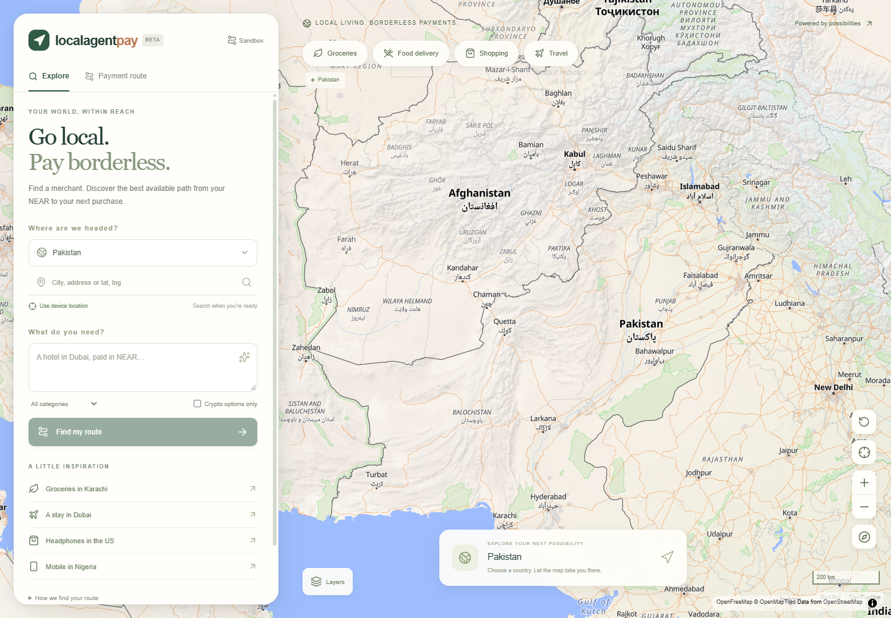

# LocalAgentPay

**Local living. Borderless payments.** A map-first, country-aware commerce route finder: describe a purchase, match real regional storefronts, and see the documented payment path before continuing with a provider.

[Public source repository](https://github.com/gsas-bit23/localagentpay)

**[Open the live Cloudflare demo](https://localagentpay.mateen-nibtap.workers.dev)**

> The home page recommends real providers from a curated directory across 12 countries. It does not query live product inventory, calculate final carts, execute checkout, or compare live prices. The separate `/demo` payment sandbox uses fictional merchants and simulated confirmation. No funds or orders are submitted by this app.



[Live payment route](docs/map-live.png) · [Mobile map](docs/map-mobile.png) · [GPS accuracy example](docs/map-gps.png)

[Watch the original sandbox recording](docs/demo.webm) · [Payment preview screenshot](docs/payment-preview.png) · [Simulated receipt](docs/confirmation.png)

## Run it

Requires Node.js 22+ and npm.

```sh
npm ci
npm run dev
```

Open http://127.0.0.1:3000. No API keys or wallet are needed for merchant routing.

1. Choose a country or include it in your request: **Weekly groceries in Karachi under PKR 5000**.
2. Review regional providers, payment compatibility, and the ranking explanation.
3. Select a result to see its proposed checkout path, evidence links, and requirements.
4. Continue on the provider to check actual stock, address eligibility, final total, and invoice.

Try **Book a hotel in Dubai and pay in NEAR**, **Buy headphones in the US using crypto**, or **Recharge my mobile in Nigeria**. The crypto-only filter excludes stores without a documented crypto checkout route. Voucher suggestions are excluded.

The directory includes Pakistan, India, the US, the UK, the UAE, Germany, Singapore, Nigeria, Canada, Australia, France, and Japan. Categories are groceries, food delivery, shopping, travel, mobile/connectivity, local services, and domains/hosting. Country coverage does not imply every city, item, or payment method is available. See [the commerce routing guide](docs/COMMERCE.md).

## Interactive map workspace

MapLibre + OpenStreetMap-based OpenFreeMap tiles provide the live full-screen background without Google billing. Floating panels contain country selection, submitted address/place search, optional device location, and merchant/payment routes. Country changes and recognized city requests animate the camera; the mobile interface uses an expandable bottom panel. Online providers are never pinned as invented physical shops. See [the map guide](docs/MAPS.md) for providers, accuracy, privacy, and configuration.

## Payment sandbox

Open `/demo` for the original fictional merchant and simulated payment experience:

1. Keep the default city, enter your own using the location button, or share approximate browser coordinates.
2. Click **Fill the fridge** or type **Find weekly groceries near me under $60**.
3. Select Green Basket, The Daily Pantry, or Roots & Co.
4. Review the selected asset and chain, the merchant's USDC output on Base, illustrative fee, and expiry.
5. Click **Simulate confirmation**. The receipt explicitly states that no money moved and no order was placed.

Try **car service under $100** (two matches), **local gifts below $30**, or **groceries under $10** (empty state).

## NEAR integration in the sandbox

The server uses the official `@defuse-protocol/one-click-sdk-typescript` package:

- `OneClickService.getTokens()` calls `GET https://1click.chaindefuser.com/v0/tokens`. Asset IDs and decimal precision come from the API, rather than hardcoded assumptions.
- `OneClickService.getQuote()` calls `POST /v0/quote` with `dry: true`, `EXACT_OUTPUT`, a 100 bps slippage tolerance, and USDC on Base as the destination.
- The selected merchant price is converted to integer output units using decimal-string arithmetic. For example, $48 becomes `48000000` USDC atomic units.
- Supported payment choices are ETH or USDC on Ethereum, and wrapped NEAR (wNEAR) on NEAR, as listed in the current 1Click catalog. Native NEAR wrapping is outside this prototype.
- The exact-output route fixes what the merchant receives. 1Click's input amount includes its 1% slippage buffer. Route costs are included; the UI does not invent a separate live network fee.
- Live quotes are estimates and use a conservative two-minute UI refresh window. A dry-run preview is not a signed executable payment intent. No deposit address is requested or displayed.
- The sample `localagentpay-demo.near` refund identifier is used only to validate the dry-run schema. It is not a user wallet or a refund destination suitable for a funded swap.

The integration is in `lib/near-intents.ts`; the user-controlled boundary is `app/api/quote/route.ts`. The **createPaymentIntent** tool is invoked only after explicit merchant selection, outside the LLM. The browser cannot override the merchant price or recipient.

The real-provider route finder uses `/api/routes`. Its provider recommendations are separate from this sandbox. A real provider's checkout must supply an invoice before an executable conversion can be built; a fictional sandbox price is never used to quote a real merchant purchase. Travala lists NEAR directly, so that path does not insert an unnecessary bridge. Uquid's crypto payment options are candidates for conversion only after confirming its actual invoice token, chain, amount, recipient, and expiry. Conventional checkout providers are marked as having no connected NEAR payment route.

### Enable a real API preview

Copy `.env.example` to `.env.local`, then set:

```dotenv
MERCHANT_BASE_ADDRESS=<merchant-controlled-0x-address-on-Base>
ONECLICK_JWT=<your-1Click-JWT-if-required>
```

Restart the server, switch to **Live API preview**, select a merchant, and request a quote. The single configured recipient is a prototype stand-in for a future per-merchant registry. An unavailable route, missing address, or authentication failure produces an error; live mode never silently substitutes mock rates. The API may require a JWT even for a dry quote. Obtain credentials through the official documentation.

**Demo quote** uses explicit fixed illustrative prices: ETH = $2,000, USDC = $1, wNEAR = $3, plus a $0.24 sample route fee. These are not market data.

### Optional NEAR AI Cloud

```dotenv
NEAR_AI_API_KEY=<your-key>
NEAR_AI_MODEL=<a-model-currently-available-in-your-NEAR-AI-account>
NEAR_AI_BASE_URL=https://cloud-api.near.ai/v1
```

The server uses the OpenAI-compatible client requested by the project brief. It forces a structured `get_nearby_options` tool call and validates its arguments. It sends the latest request, city, and category hint; there is no conversational memory. Coordinates are not sent to the model. The assistant uses deterministic local rules if credentials are absent, the model call fails, or the response is invalid. The UI labels the source as **Demo assistant** or **NEAR AI**. No available model ID is assumed.

## Architecture

```text
app/page.tsx                  Map-first merchant route finder
app/demo/page.tsx             Original simulated payment sandbox
app/api/routes/route.ts       Validate request → country/category filter → ranked routes
app/api/chat/route.ts         Validate request → optional NEAR AI tool → options
app/api/location/route.ts     Structured sample location/options endpoint
app/api/quote/route.ts        Merchant lookup → explicit demo or 1Click dry-run
components/Chat.tsx           Chat, location, choice, and confirmation state
components/RouteFinder.tsx    Floating panels, location and merchant routing state
components/MapCanvas.tsx      Persistent MapLibre map, animated camera, markers, accuracy
app/api/map/search/route.ts   Validated submitted Photon location searches
lib/maps/                    Camera presets, coordinate handling, Photon normalization
components/OptionsList.tsx    Selectable fictional merchants
components/PaymentCard.tsx    Asset, chains, fee, expiry, simulated receipt
lib/agent.ts                 System prompt, function schema, deterministic fallback
lib/merchants.ts             Fictional data and budget filtering
lib/near-intents.ts           Official 1Click SDK wrapper
lib/validation.ts             Request validation and atomic amount conversion
lib/commerce/                 Real provider registry, supported countries, routing policy
tests/core.test.ts            Amount precision, filtering, input, and mode checks
tests/routing.test.ts         Country isolation, crypto eligibility, ranking, and unknown prices
```

In the sandbox, the browser's chat request includes the current location, so it does not need to call the standalone location endpoint first. Sharing approximate coordinates is optional and does not alter fixture distances. No location is persisted; the server has no database. Geolocation requires HTTPS or localhost and permission; denial leaves typed-city input available. The map workspace optionally uses device location with a reported accuracy circle. Country/city context is used for merchant routing. Submitted address searches and explicit nearby store searches use Photon; map tiles reflect the visible area. See [map setup and privacy](docs/MAPS.md).

## Check and build

```sh
npm test
npm run typecheck
npm run build
npm start
```

The lockfile pins resolved dependencies. The optional workflow in `docs/ci.yml.example` runs the same checks. To enable it, copy it to `.github/workflows/ci.yml` using GitHub credentials with the `workflow` scope; the current publishing credential cannot enable Actions. For any Node-compatible Next.js host, use `npm ci`, `npm run build`, and `npm start` with the relevant server-only environment variables. Run behind HTTPS for remote geolocation.

## Cloudflare Workers

The app also builds for Workers using Cloudflare's Vinext runtime. The original Next.js commands above remain available.

`npm run typecheck` regenerates Next.js route definitions before checking types, so it works after either build pipeline.

Deployed at **https://localagentpay.mateen-nibtap.workers.dev**. The public browser flow and API endpoints were verified after deployment. [View the deployed receipt screenshot](docs/cloudflare-live.png).

```sh
npm run build:vinext
npm run start:vinext
# After checking the local Worker:
npm run deploy:vinext -- --skip-build
```

`wrangler.jsonc` pins the target account and Worker name. For your own fork, update `account_id` and `name`, then authenticate with `npx wrangler login`. The build emits `dist/client` assets and a server Worker at `dist/server/index.js`; generated files and Wrangler state are ignored by Git. No KV, database, image optimization service, or response cache is needed for this prototype.

The deployed home page is the real-provider route finder, with no embedded checkout execution. The `/demo` sandbox defaults to fictional merchants and simulated confirmation. To configure the sandbox's optional live services, set secrets on the Worker rather than committing `.env` files:

```sh
npx wrangler secret put MERCHANT_BASE_ADDRESS
npx wrangler secret put ONECLICK_JWT
npx wrangler secret put NEAR_AI_API_KEY
npx wrangler secret put NEAR_AI_MODEL
```

Only set the services you intend to use. Local Next.js development still reads `.env.local`; Wrangler local preview can use an ignored `.dev.vars` file. Node.js compatibility is enabled for the SDKs and server environment access.

## API examples

```sh
curl -X POST http://127.0.0.1:3000/api/routes -H "Content-Type: application/json" -d '{"query":"groceries in Pakistan","cryptoOnly":false}'
curl -X POST http://127.0.0.1:3000/api/chat -H "Content-Type: application/json" -d '{"message":"groceries under $50","location":{"city":"San Francisco"}}'
curl -X POST http://127.0.0.1:3000/api/quote -H "Content-Type: application/json" -d '{"merchantId":"green-basket","asset":"ETH","mode":"demo"}'
```

Invalid inputs return 400, unknown merchants 404, configuration/provider failures 422. Quotes have no custody or transfer side effects. A public production service still needs authentication, rate limiting, persisted merchant verification, a real quote-to-wallet funding flow, provider status polling, and fulfillment integration before accepting money.

## Hackathon submission

Suggested tracks: **Agent Economy** and **Real-World Money**. The natural-language commerce workflow plus NEAR Intents exact-output routing is the core demonstration.

See `docs/DEMO.md` for a 60–90 second recording script, X post draft, and submission checklist. The supplied brief lists November 14, 2026 at 23:59 UTC (November 15 at 04:59 in Pakistan) as the deadline; verify it against the organizer's current rules before submitting.

## References

- [NEAR Intents documentation](https://docs.near-intents.org)
- [1Click API integration](https://docs.near-intents.org/near-intents/integration/distribution-channels/1click-api)
- [Official TypeScript SDK](https://github.com/defuse-protocol/one-click-sdk-typescript)
- [NEAR AI Cloud](https://cloud.near.ai)

MIT licensed. Built as a prototype for the NEAR Hackathon.
